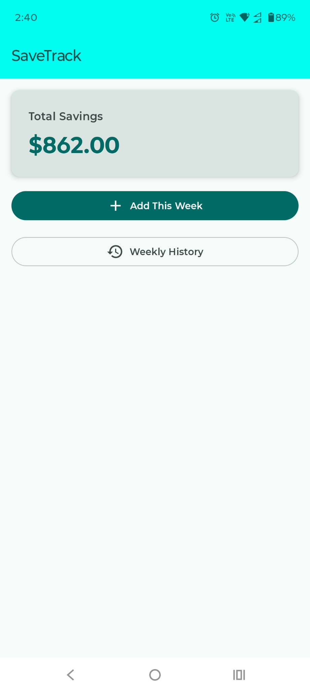
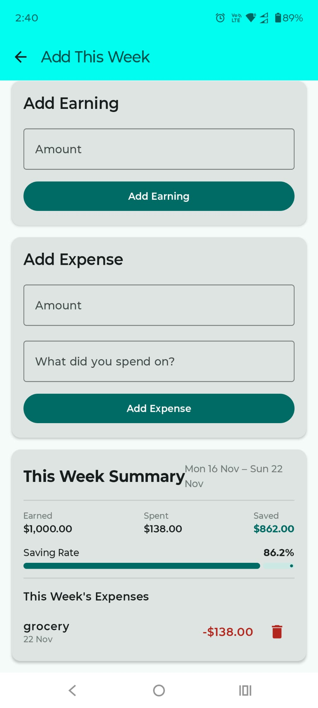
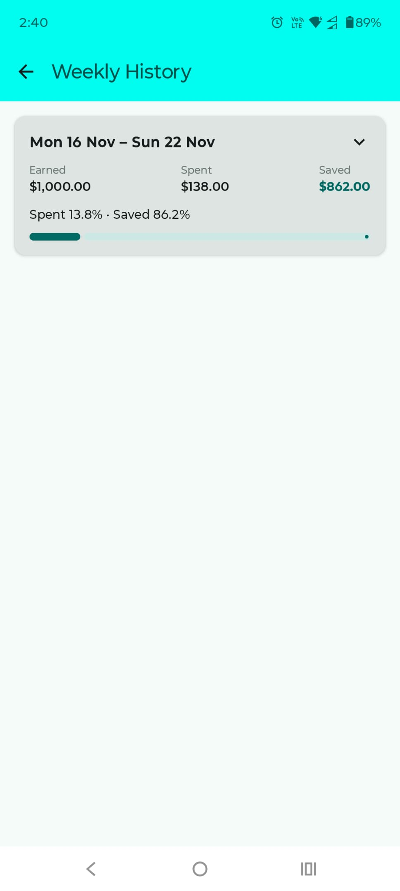

# SaveTrack

A personal finance Android app that tracks weekly earnings and expenses, shows your total savings, and breaks down how much of each week's income you spent and saved.

Built with **Kotlin** and **Jetpack Compose**, using **MVVM** and a local **Room** database.

## Screenshots

| Home | Add This Week | Weekly History |
| :---: | :---: | :---: |
|  |  |  |

## Features

- **Total savings** on the home screen, updated live (all earnings minus all expenses)
- **Add earnings** and **add expenses** with the item name (e.g. "Groceries"), with input validation
- **This week summary** (Monday to Sunday): earned, spent, saved and saving rate with a progress bar
- **Expense list** for the current week, with delete
- **Weekly history**: every past week as a card showing earned, spent, saved and "Spent X% · Saved Y%"; tap a card to see what the money was spent on
- Amounts shown in **NZD**; data is stored on the device, so the app works offline

## Tech stack

| Area | Technology |
| --- | --- |
| Language | Kotlin |
| UI | Jetpack Compose, Material 3 |
| Architecture | MVVM, StateFlow, Repository pattern, manual dependency injection |
| Database | Room (SQLite) with Kotlin Flow |
| Navigation | Navigation Compose |
| Async | Kotlin Coroutines |

## Architecture

```
UI (Compose screens)
   ↓ user actions        ↑ StateFlow<UiState>
ViewModels (Home, AddWeek, History)
   ↓                     ↑ Flow<List<Transaction>>
TransactionRepository
   ↓                     ↑
Room database (TransactionDao → transactions table)
```

- Each screen observes a `StateFlow` from its ViewModel, so the UI updates automatically when data changes.
- All maths (totals, weekly grouping, percentages) is done in the ViewModels, not in the UI.
- Weeks run from Monday 00:00 to Sunday 23:59.

## Project structure

```
app/src/main/java/com/emon/savetrack/
├── data/
│   ├── local/          # Room entity, DAO and database
│   └── repository/     # TransactionRepository
├── ui/
│   ├── home/           # Home screen + ViewModel
│   ├── addweek/        # Add earnings/expenses + weekly summary
│   ├── history/        # Weekly history screen + ViewModel
│   ├── navigation/     # NavGraph
│   └── theme/
├── MainActivity.kt
└── SaveTrackApplication.kt
```

## Download

Get the latest APK from the [Releases page](https://github.com/emonitnz/SaveTrack/releases) and install it on an Android phone (Android 7.0 or later).

## Run it yourself

1. Clone the repo: `git clone https://github.com/emonitnz/SaveTrack.git`
2. Open the folder in Android Studio.
3. Let Gradle sync, then click **Run** on an emulator or a connected phone.

## Planned improvements

- Expense categories and a spending chart
- Edit an existing entry
- Unit tests for the ViewModels
- Export data to CSV

## Author

**Mohammad Emon**, Computer Science graduate, University of Waikato
[GitHub](https://github.com/emonitnz) · [LinkedIn](https://www.linkedin.com/in/mohammad-emon-332a22391)
